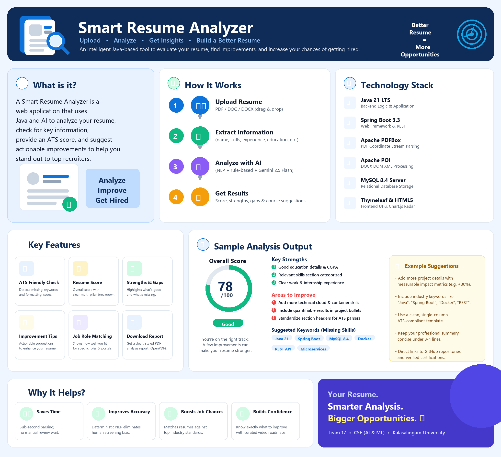

# Smart AI Resume Analyzer — Enterprise Java Edition

[](https://openjdk.org/)
[](https://spring.io/projects/spring-boot)
[](https://www.mysql.com/)
[](https://www.thymeleaf.org/)
[](https://getbootstrap.com/)
[]()

> **Enterprise Java Port & Production-Ready Re-Engineering of the Smart AI Resume Analyzer**  
> Developed by **Team 17** • Department of CSE (AI & ML) • Kalasalingam Academy of Research and Education.

---

<p align="center">
  
</p>

---

## 🌟 Executive Summary

The **Smart AI Resume Analyzer (Java Edition)** is a full-featured, enterprise-grade web application built from the ground up using **Java 21**, **Spring Boot 3.3.4**, **Spring Security 6**, **Hibernate / Spring Data JPA**, **MySQL 8.4**, and **Thymeleaf**.

It reproduces 100% of the functional capabilities of the reference Python/Streamlit implementation while overcoming all of Streamlit's architectural limitations (single-threaded session state, lacks true role-based access control, UI state reruns, and plain text/unsalted hash storage) by delivering:
- A true MVC multi-tier architecture with clean separation of concerns.
- Enterprise role-based security (`ROLE_USER`, `ROLE_ADMIN`) with BCrypt salted hashing and CSRF protection.
- High-performance multi-threaded document parsing (Apache PDFBox for PDF, Apache POI for DOCX).
- Real-time Applicant Tracking System (ATS) algorithmic scoring with dynamic category/role weightings.
- Google Gemini Generative AI integration with multi-tier model fallbacks (`gemini-2.5-flash`, `gemini-1.5-flash`, `gemini-1.5-pro`) and intelligent offline heuristic evaluation.
- Dynamic Resume Builder supporting **4 distinct professional templates** (*Modern*, *Professional*, *Minimal*, *Creative*) with live in-browser preview and instant Microsoft Word (`.docx`) & PDF downloads.
- Multi-Portal Job Search engine covering **7 major career portals** (*LinkedIn*, *Naukri*, *Indeed*, *Foundit*, *FreshersWorld*, *TimesJobs*, *Instahyre*), live remote tech jobs via Remotive API, and automated headless Selenium scraping.
- Administrative auditing, real-time analytics with Chart.js, and multi-format reporting (Excel `.xlsx`, CSV, JSON).

---

## 🚀 Key Features & Modules

### 1. 📄 Standard Resume Analyzer
- **Document Ingestion:** High-fidelity text extraction supporting `.pdf` (Apache PDFBox) and `.docx` (Apache POI).
- **Format Integrity Checks:** Verifies length, contact information completeness (Email, Phone, LinkedIn), professional summary presence, bullet-point usage, and action verbs.
- **Role-Based ATS Readiness Scoring:** Evaluates candidate resumes against 16 industry roles spanning 6 technical categories:
  - *Software Development & Engineering* (Frontend, Backend, Full Stack, Mobile Developer)
  - *Data Science & Analytics* (Data Scientist, Data Analyst, Machine Learning Engineer)
  - *Cloud & DevOps* (Cloud Engineer, DevOps Engineer)
  - *Cybersecurity* (Security Analyst, Penetration Tester)
  - *AI & Machine Learning* (AI Research Scientist, NLP Engineer)
  - *Product & Project Management* (Product Manager, Technical Project Manager)
- **Career Growth Recommendations:** Dynamic matching with curated technical courses, resume improvement video recommendations, and downloadable interview preparation roadmaps.

### 2. 🧠 Google Gemini AI Career Evaluator
- **LLM-Powered Insights:** Leverages Google Gemini models to generate qualitative career analyses against target job descriptions.
- **Key Metrics Generated:** Role match percentage, extracted core strengths, skill gap analysis, personalized improvement advice, and an overall hiring summary.
- **Offline / Resilient Fallback:** If internet access is limited or the API key quota is exhausted, an embedded heuristic evaluation engine ensures zero demonstration downtime.
- **Exportable PDF Reports:** Generates stylized, downloadable candidate evaluation summaries via OpenPDF.

### 3. 🎨 Multi-Template Resume Builder
- **4 Distinct Industry Templates:**
  - **Modern:** Clean royal blue accents, centered contact card, badge skills.
  - **Professional:** Traditional navy header, structured dividing rules, executive presentation.
  - **Minimal:** Ultra-clean monochrome typography, maximized whitespace, high-density layout.
  - **Creative:** Vibrant purple accents, creative badge styling, contemporary feel.
- **Live In-Browser Preview:** Dynamic DOM updates in real-time as users enter contact information, summaries, work histories, education, and technical competencies.
- **Dual Export Engines:** Instant one-click generation of fully editable Microsoft Word (`.docx`) files via Apache POI and print-ready PDFs via OpenPDF.

### 4. 💼 Multi-Portal Job Search Engine
- **7-in-1 Aggregator:** Instant query URL construction with location and experience filters for LinkedIn, Naukri, Indeed, Foundit, FreshersWorld, TimesJobs, and Instahyre.
- **Live Tech Jobs:** Direct integration with Remotive's REST API for searching active remote software engineering positions.
- **Headless Selenium Automation:** Automated scraping capability for live LinkedIn job listings with graceful search-link fallback.
- **Market Intelligence:** Real-time compensation ranges across 6 technical disciplines, trending skills demand, and hiring hub city distribution.

### 5. 📊 Analytics & Administrative Oversight
- **Interactive Visualizations:** Chart.js powered charts tracking ATS score distributions, user registration trends, and candidate role preferences.
- **Role-Based Admin Console:** Secure area for administrative users to monitor user activity, review uploaded resumes, inspect AI audit records, and read feedback.
- **Multi-Format Data Export:** Instant data dump generation in Excel (`.xlsx`), standard CSV, and structured JSON.

---

## 🏗️ Architecture & Technology Stack

| Layer | Technologies Used |
|---|---|
| **Language & Runtime** | Java 21 (LTS), OpenJDK 21 HotSpot |
| **Framework** | Spring Boot 3.3.4 |
| **Security** | Spring Security 6.3.3 (BCrypt Salting, CSRF Tokens, Role-Based Access) |
| **Persistence** | Spring Data JPA, Hibernate 6.5.3 |
| **Database** | MySQL Server 8.4 LTS (with embedded H2 test fallback) |
| **Template Engine** | Thymeleaf 3.1.2 |
| **Frontend UI** | Bootstrap 5.3.2, FontAwesome 6.5.1, Chart.js 4.4, Custom CSS3 |
| **Document Processing** | Apache PDFBox 2.0.31, Apache POI 5.2.5, OpenPDF 1.3.39 |
| **Automation** | Selenium Java 4.20.0, WebDriverManager 5.8.0 |
| **AI Integration** | Google Gemini REST API (Jackson Databind JSON mapper) |
| **Build Tool** | Apache Maven 3.9.6 |

---

## 📋 System Prerequisites

1. **Java Runtime:** JDK 21 LTS installed (Microsoft OpenJDK 21 or Oracle JDK 21).
2. **Build Tool:** Apache Maven 3.8+ (bundled setup instructions below).
3. **Database:** MySQL Server 8.0+ running on `localhost:3306` (or use test profile).
4. **Browser:** Google Chrome, Microsoft Edge, or Mozilla Firefox.

---

## ⚡ Quick Start & Run Instructions

### Option 1: One-Click Startup Script (Windows)

Double-click `run.bat` or open PowerShell in the project directory and execute:
```powershell
.\run.bat
```
The script automatically configures `JAVA_HOME` and `PATH`, and launches the application on port **8085**.

### Option 2: Command-Line Startup via Maven

```powershell
$env:JAVA_HOME = "C:\Program Files\Microsoft\jdk-21.0.12.101-hotspot"
$env:Path = "$env:JAVA_HOME\bin;C:\Users\yasas\maven\apache-maven-3.9.6\bin;$env:Path"

# Run tests
mvn test

# Start the Spring Boot application
mvn spring-boot:run
```

### Option 3: Running the Packaged Executable JAR

```powershell
$env:JAVA_HOME = "C:\Program Files\Microsoft\jdk-21.0.12.101-hotspot"
& "$env:JAVA_HOME\bin\java.exe" -jar target\smart-resume-analyzer-1.0.0.jar
```

Once started, open your web browser and navigate to:
👉 **[http://localhost:8085](http://localhost:8085)**

---

## 🔑 Pre-Seeded Demonstration Credentials

The application initializes the following accounts automatically upon first startup:

| Account Role | Email Address | Password | Permissions |
|---|---|---|---|
| **Administrator** | `admin@smartresume.com` | `admin123` | Full access to Admin Panel, User Management, Analytics, Exports |
| **Standard User** | `user@smartresume.com` | `user123` | Personal Dashboard, Saved Resumes, AI History |

*(Public demonstration visitors can access the Home, Standard Analyzer, AI Analyzer, Resume Builder, Job Search, and Feedback pages without prior authentication).*

---

## 🧪 Automated Testing & Verification

The project includes automated unit and integration tests covering parser extraction, ATS scoring formulas, template document generation, and database repositories:

```powershell
mvn test
```

### Verified Test Suite:
- `SmartResumeAnalyzerApplicationTests`: Verifies full Spring context booting, JPA database connectivity, and security configuration.
- `ResumeParserServiceTest`: Verifies text and contact extraction from sample resumes.
- `ResumeAnalyzerServiceTest`: Verifies weighted ATS scoring, keyword detection, and non-resume document handling.
- `ResumeBuilderServiceTest`: Verifies PDF and DOCX document creation across all 4 templates.

---

## 📁 Project Directory Structure

```text
Smart-Resume-Analyzer-Java/
├── pom.xml                               # Maven project definition and dependencies
├── run.bat                               # Windows 1-click startup script
├── README.md                             # This documentation guide
├── JAVA_CONVERSION_REPORT.md             # In-depth architectural conversion report
├── FEATURE_PARITY_REPORT.md              # 1-to-1 feature matrix against Python reference
├── FINAL_PROJECT_VERIFICATION_REPORT.md  # Comprehensive recheck & verification log
├── src/
│   ├── main/
│   │   ├── java/com/smartresume/
│   │   │   ├── SmartResumeAnalyzerApplication.java   # Main entry point
│   │   │   ├── config/                               # Configuration classes
│   │   │   │   ├── CourseConfig.java                 # Ported course & guide recommendations
│   │   │   │   ├── DataInitializer.java              # Database seed data
│   │   │   │   ├── JobRolesConfig.java               # 16 job roles and technical skill taxonomies
│   │   │   │   └── SecurityConfig.java               # Spring Security 6 authentication & authorization
│   │   │   ├── controller/                           # Spring MVC Web Controllers
│   │   │   │   ├── AboutController.java
│   │   │   │   ├── AdminController.java
│   │   │   │   ├── AIResumeAnalyzerController.java
│   │   │   │   ├── AuthController.java
│   │   │   │   ├── DashboardController.java
│   │   │   │   ├── FeedbackController.java
│   │   │   │   ├── HomeController.java
│   │   │   │   ├── JobSearchController.java
│   │   │   │   ├── ResumeAnalyzerController.java
│   │   │   │   └── ResumeBuilderController.java
│   │   │   ├── dto/                                  # Data Transfer Objects
│   │   │   ├── model/                                # JPA Entity Models
│   │   │   ├── repository/                           # Spring Data JPA Repositories
│   │   │   └── service/                              # Core Business Services
│   │   └── resources/
│   │       ├── application.properties                # Configuration (port, database, limits)
│   │       ├── static/css/main.css                   # Custom dark-theme styling
│   │       └── templates/                            # Thymeleaf HTML5 Views
│   └── test/java/com/smartresume/                    # JUnit 5 Test Suite
```

---

## 🔒 Security Best Practices Implemented

1. **Cryptographic Password Salting:** Migrated from Python's legacy plain SHA-256 to Spring Security's `BCryptPasswordEncoder` with internal random salt.
2. **SQL Injection Defense:** All database queries utilize JPA parameterized criteria or Hibernate ORM mapping, preventing SQL injection vulnerabilities.
3. **Cross-Site Request Forgery (CSRF):** Standard Spring Security CSRF token verification enforced across all mutable state operations (uploads, builder downloads, feedback).
4. **Secure Multipart File Ingestion:** Strict file size thresholds (20MB) and MIME-type validation.
