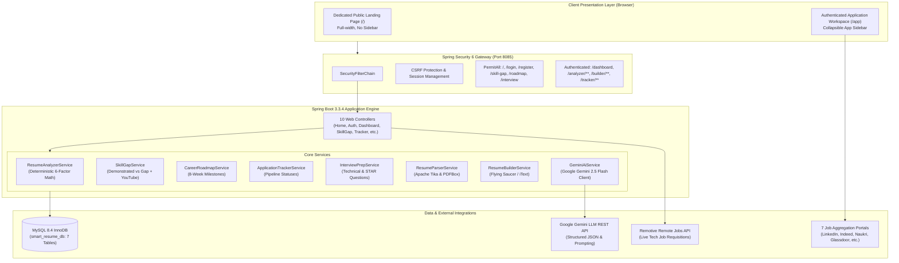

# Architecture & Data Flow

**Smart Resume AI — Technical Architecture**  
*Document Version: 2.0.0*  
*Generated: October 2026*

---

## 1. System Architecture Diagram



---

## 2. Core Architectural Subsystems

### 2.1 Presentation Tier (Dual-Layout Architecture)
To eliminate visitor confusion, the user interface is strictly divided:
1. **Public Layout (`layout/public.html`)**:
   - Renders for anonymous and public marketing pages (`/`, `/#features`, `/#workflow`, `/#roles`, `/#skills`, `/#formula`, `/about`).
   - Displays a clean horizontal top navigation bar with brand emblem, section links, and auth CTAs (`Sign In`, `Get Started Free`).
   - Contains **zero internal dashboard elements** and **zero sidebars**.
2. **Authenticated Layout (`layout/base.html`)**:
   - Renders for authenticated user routes (`/dashboard`, `/analyzer/**`, `/builder/**`, `/tracker/**`, `/roadmap`, `/interview`, `/admin`).
   - Displays the dedicated three-tier sidebar navigation:
     - **Workspace**: Upload & Scan, AI Coach, Resume Builder.
     - **Career Acceleration**: Skill Gaps & YouTube Hub, 8-Week Roadmap, Job Discovery, Application Tracker, Interview Prep.
     - **Platform & Links**: Documentation, Admin Console (Role-guarded), Profile & Sign Out.

---

### 2.2 Security Architecture & Route Enforcement
Configured in `SecurityConfig.java`:
```java
http
    .authorizeHttpRequests(auth -> auth
        .requestMatchers(
            "/", "/home", "/about", "/contact",
            "/login", "/register",
            "/css/**", "/js/**", "/images/**", "/webjars/**",
            "/skill-gap", "/skill-gap/**",
            "/roadmap", "/roadmap/**",
            "/interview", "/interview/**"
        ).permitAll()
        .requestMatchers("/admin/**").hasRole("ADMIN")
        .requestMatchers("/dashboard/**", "/analyzer/**", "/builder/**", "/tracker/**", "/app/**").authenticated()
        .anyRequest().authenticated()
    )
    .formLogin(form -> form
        .loginPage("/login")
        .defaultSuccessUrl("/dashboard", true)
        .permitAll()
    )
    .logout(logout -> logout
        .logoutUrl("/logout")
        .logoutSuccessUrl("/login?logout")
        .permitAll()
    );
```

---

### 2.3 Data Flow: The Closed-Loop Career Pipeline

1. **Resume Upload**: User submits PDF $\rightarrow$ `ResumeParserService` extracts text $\rightarrow$ PII regex masks phone/email/IDs $\rightarrow$ Persists `Resume` entity to MySQL.
2. **ATS Audit**: `ResumeAnalyzerService` runs the 6-factor deterministic calculation $\rightarrow$ Produces `AnalysisResultDto` $\rightarrow$ Persists `Analysis` entity $\rightarrow$ Displays grade report.
3. **Skill Gap Remediation**: `SkillGapController` sends resume text to `SkillGapService` $\rightarrow$ Segregates skills into Demonstrated, Weak, and Missing $\rightarrow$ Injects curated YouTube tutorials (title, channel, duration, rationale) and documentation URLs into the view.
4. **Career Roadmap Generation**: `CareerRoadmapService` generates an 8-week structured sprint plan with weekly milestones and deliverables.
5. **Job Aggregation**: `JobSearchController` fetches real-time jobs from Remotive API $\rightarrow$ Prepares formatted deep-links for 7 major portals (LinkedIn, Naukri, Indeed, etc.).
6. **Application Tracking**: User clicks **Save to Tracker** $\rightarrow$ `ApplicationTrackerService` saves job to `JobMatch` table with status `SAVED` $\rightarrow$ User manages pipeline (`APPLIED` $\rightarrow$ `INTERVIEWING` $\rightarrow$ `OFFERED`).
7. **Interview Simulation**: `InterviewPrepService` outputs tailored technical questions, system architecture scenarios, and STAR behavioral interview questions.
