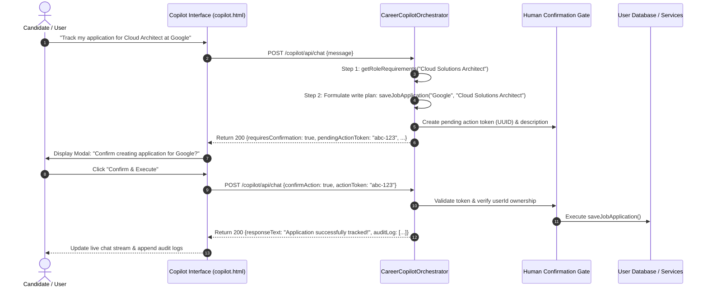

# Career Copilot Agent Design — Safe Multi-Tool Orchestration

## 1. System Architecture & Objectives
The Career Copilot ([`CareerCopilotOrchestrator.java`](file:///c:/Users/yasas/OneDrive/Documents/Desktop/D3js%20program/AI%20Smart%20Resume%20Analyzer.java/Smart-Resume-Analyzer-Java/src/main/java/com/smartresume/agent/CareerCopilotOrchestrator.java)) is an agentic assistant designed to guide candidates across their career journey while guaranteeing safety, determinism, and user consent.

Unlike unconstrained chat agents that can invoke arbitrary commands or write to databases without permission, the Career Copilot enforces four strict guardrails:
1. **Allowlisted Tool Registry**: Exactly 17 pre-defined tools (12 read-only, 5 write-actions). No unlisted tool can ever be invoked.
2. **Bounded Execution Budget**: A maximum of 5 tool hops per query to eliminate infinite execution loops.
3. **User Resource Isolation**: Every tool call enforces strict `userId` scoping, preventing access or mutation of other users' resumes, applications, or profile data.
4. **Human Confirmation Gate**: All 5 state-mutating write actions halt execution and require user verification via an interactive modal with a single-use action token.

---

## 2. Complete Allowlisted Tool Registry (17 Tools)

### A. Read-Only Retrieval Tools (12 Tools)
These tools execute automatically within the bounded 5-step budget:

| Tool Name | Scope / Responsibility | Input Parameters | Output Summary |
| :--- | :--- | :--- | :--- |
| `getCareerProfile` | Retrieves current candidate target role, verified skills, and experience level | `userId` | User profile object |
| `getRoleRequirements` | Retrieves canonical skills, prerequisite degrees, and portfolio benchmarks for a role | `roleName` | `RoleDefinition` metadata |
| `getSkillGap` | Compares candidate skills against role requirements to calculate missing competencies | `candidateSkills`, `targetRole` | List of missing skills & coverage ratio |
| `getLearningRoadmap` | Generates a time-budgeted study plan with curated tutorials and milestone projects | `targetRole`, `hoursPerWeek` | Weekly learning curriculum |
| `getLiveJobMatches` | Queries verified remote and local job openings filtered by candidate target role | `roleName`, `locationFilter` | List of job listings with application links |
| `getAtsEvaluation` | Performs 6-factor deterministic ATS scoring on an uploaded resume | `resumeId`, `targetRole` | Score (0-100), breakdown, and recommendations |
| `retrieveCareerKnowledge`| Performs hybrid RAG retrieval against verified industry standard chunks | `query` | Grounded chunks with source citations |
| `getApplicationHistory` | Retrieves candidate job application statuses (Saved, Applied, Interviewing, Offered) | `userId` | Tracked application records |
| `getInterviewQuestions` | Generates technical and behavioral STAR questions for a target role | `roleName`, `experienceLevel` | Curated question bank with rubrics |
| `getPortfolioBenchmarks`| Retrieves reference architectures and project requirements for target competencies | `roleName` | GitHub project blueprints |
| `getSavedResumes` | Lists active resume versions uploaded by the authenticated candidate | `userId` | Resume document metadata |
| `getPlatformStatistics`| Retrieves system-wide role counts, canonical skill totals, and active models | *(none)* | Aggregate platform metrics |

---

### B. State-Mutating Write Actions (5 Tools — Human Gate Enforced)
These actions cannot execute silently. When the orchestrator decides a write action is necessary, it pauses, generates a secure `pendingActionToken`, and requests explicit user confirmation:

| Tool Name | Action Description | Security / Gate Check |
| :--- | :--- | :--- |
| `updateCareerProfile` | Modifies candidate target role or stated professional goals | Modal confirmation with diff display |
| `saveJobApplication` | Tracks a new job listing in the candidate's personal Kanban tracker | Modal confirmation with company & title |
| `updateApplicationStatus`| Transitions application status (e.g., from 'Applied' to 'Interviewing') | Confirmation of target stage |
| `enrollInLearningRoadmap` | Pins a learning roadmap to the candidate dashboard with target completion date | Confirmation of study hour commitment |
| `triggerModelRetrain` | *(Admin only)* Dispatches an automated retraining cycle with validated datasets | Double-confirmation with dataset consent check |

---

## 3. Human Confirmation Gate Workflow



---

## 4. Audit Log Data Structure
Every step executed by the agent is recorded and returned in the API payload:
```json
{
  "toolName": "getSkillGap",
  "argumentsSummary": "Candidate: [Python, Git], Target: Full Stack Developer",
  "resultSummary": "Identified 8 gaps: [Java, JavaScript, React, Spring Boot, SQL, HTML5, CSS3, REST APIs]",
  "timestamp": "2026-10-31T00:21:45.6214255"
}
```
The audit log stream is visible in real-time in the Copilot UI (`/copilot`), allowing candidates and reviewers to verify the step-by-step reasoning behind every suggestion.
