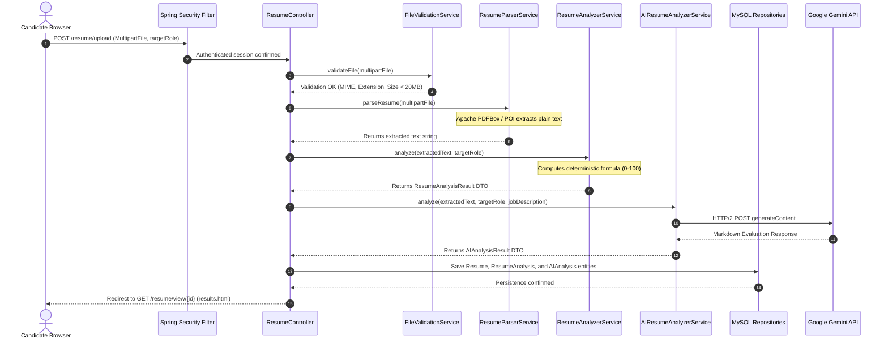

# Current Application Workflow & Resume Processing Trace

## Project: Smart AI Resume Analyzer
**Framework:** Spring Boot 3.3.4 | Java 21 LTS  
**Audit Date:** October 30, 2026  
**Status:** **Verified End-to-End Processing Flow**

---

## 1. Complete Step-by-Step Resume Processing Lifecycle

---

## 2. In-Depth Trace by Component

### Step 1: User Uploads Resume
* **Route:** `POST /resume/upload`
* **Handling Method:** `ResumeController.handleUpload(@RequestParam("file") MultipartFile file, @RequestParam("targetRole") String targetRole, Principal principal)`
* **File Location:** [`src/main/java/com/smartresume/controller/ResumeController.java`](file:///c:/Users/yasas/OneDrive/Documents/Desktop/D3js%20program/AI%20Smart%20Resume%20Analyzer.java/Smart-Resume-Analyzer-Java/src/main/java/com/smartresume/controller/ResumeController.java)

### Step 2: Backend File Validation
* **Handling Method:** `FileValidationService.validateFile(MultipartFile file)`
* **File Location:** [`src/main/java/com/smartresume/service/FileValidationService.java`](file:///c:/Users/yasas/OneDrive/Documents/Desktop/D3js%20program/AI%20Smart%20Resume%20Analyzer.java/Smart-Resume-Analyzer-Java/src/main/java/com/smartresume/service/FileValidationService.java)
* **Checks:** File non-empty, extension whitelist (`.pdf`, `.docx`), size cap ($< 20\text{MB}$).
* **Limitation:** Validates HTTP multipart header MIME type; does not inspect physical magic bytes.

### Step 3: Text Extraction (PDF / DOCX)
* **Handling Method:** `ResumeParserService.parsePdf(InputStream is)` and `parseDocx(InputStream is)`
* **File Location:** [`src/main/java/com/smartresume/service/ResumeParserService.java`](file:///c:/Users/yasas/OneDrive/Documents/Desktop/D3js%20program/AI%20Smart%20Resume%20Analyzer.java/Smart-Resume-Analyzer-Java/src/main/java/com/smartresume/service/ResumeParserService.java)
* **Underlying Engines:**
  - PDF: `org.apache.pdfbox.text.PDFTextStripper`
  - DOCX: `org.apache.poi.xwpf.usermodel.XWPFDocument`

### Step 4: Text Normalization & Sectioning
* **Handling Method:** `ResumeParserService.extractSections(String text)`
* **Logic:** Segregates text into Summary, Work History, Education, Skills, and Projects using regex pattern matchers on standard uppercase headings.

### Step 5: Keyword & Skill Matching
* **Handling Method:** `ResumeAnalyzerService.calculateKeywordMatch(String text, List<String> requiredSkills, ResumeAnalysisResult result)`
* **File Location:** [`src/main/java/com/smartresume/service/ResumeAnalyzerService.java` L215](file:///c:/Users/yasas/OneDrive/Documents/Desktop/D3js%20program/AI%20Smart%20Resume%20Analyzer.java/Smart-Resume-Analyzer-Java/src/main/java/com/smartresume/service/ResumeAnalyzerService.java#L215)
* **Logic:** Compares normalized text against `JobRolesConfig` skill lists using `text.toLowerCase().contains(skill.toLowerCase())`.

### Step 6: Deterministic ATS Scoring
* **Handling Method:** `ResumeAnalyzerService.analyze(String text, String targetRole)`
* **Formula:**
  $$\text{ATS Score} = (S_{\text{contact}} \times 0.10) + (S_{\text{summary}} \times 0.10) + (S_{\text{keyword}} \times 0.30) + (S_{\text{exp}} \times 0.20) + (S_{\text{edu}} \times 0.10) + (S_{\text{format}} \times 0.20)$$

### Step 7: Qualitative AI Evaluation
* **Handling Method:** `AIResumeAnalyzerService.analyze(String resumeText, String jobRole, String category, String jobDescription, String customKey)`
* **File Location:** [`src/main/java/com/smartresume/service/AIResumeAnalyzerService.java`](file:///c:/Users/yasas/OneDrive/Documents/Desktop/D3js%20program/AI%20Smart%20Resume%20Analyzer.java/Smart-Resume-Analyzer-Java/src/main/java/com/smartresume/service/AIResumeAnalyzerService.java)
* **Call Path:** Asynchronous HTTP/2 call to Google Gemini (`gemini-2.5-flash`). Fallback to local heuristic analyzer if offline.

### Step 8: Database Persistence
* **Entities Created:**
  1. `Resume`: File name, target role, raw text.
  2. `ResumeAnalysis`: ATS score breakdown, matched/missing skills JSON.
  3. `AIAnalysis`: Gemini qualitative assessment, strengths, weaknesses.
* **Repositories:** `ResumeRepository.save()`, `ResumeAnalysisRepository.save()`, `AIAnalysisRepository.save()`.

### Step 9: View Rendering on Dashboard
* **Route:** `GET /resume/view/{id}`
* **Template:** `src/main/resources/templates/resume/results.html`
* **Visuals Rendered:** Circular SVG ATS score dial, Chart.js radar breakdown, green/red keyword badges, Gemini strengths & recommendations list.
