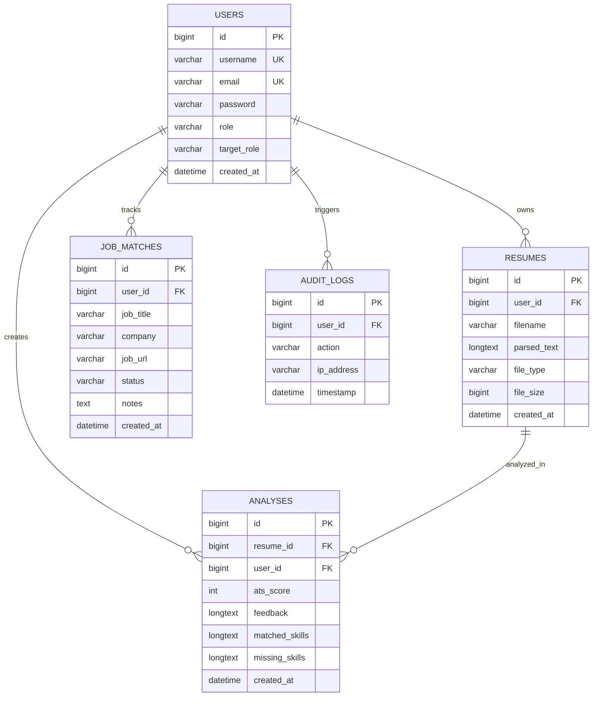

# Database & Security Audit

**Smart Resume AI — Data Integrity, Privacy & Security Audit**  
*Document Version: 2.0.0*  
*Generated: October 2026*

---

## 1. Database Architecture & Schema Verification

The application utilizes **MySQL Community Server 8.4 (InnoDB)** running locally on port 3306, managing the database `smart_resume_db`.

### Entity-Relationship Overview:

---

## 2. Table Specifications & Indexing Strategy

1. **`users`**:
   - `id` (BIGINT, Primary Key, Auto Increment)
   - `username` (VARCHAR(50), Unique Index)
   - `email` (VARCHAR(100), Unique Index)
   - `password` (VARCHAR(255), BCrypt Hashed)
   - `role` (VARCHAR(20), e.g. `ROLE_USER`, `ROLE_ADMIN`)
   - `target_role` (VARCHAR(100))
2. **`resumes`**:
   - `id` (BIGINT, Primary Key)
   - `user_id` (BIGINT, Foreign Key referencing `users.id`, Indexed)
   - `filename` (VARCHAR(255))
   - `parsed_text` (LONGTEXT, PII-sanitized resume content)
3. **`analyses`**:
   - `id` (BIGINT, Primary Key)
   - `resume_id` (BIGINT, Foreign Key referencing `resumes.id`)
   - `ats_score` (INT, 0 to 100)
   - `matched_skills` (LONGTEXT, comma-separated or JSON array)
   - `missing_skills` (LONGTEXT, comma-separated or JSON array)
4. **`job_matches`**:
   - `id` (BIGINT, Primary Key)
   - `user_id` (BIGINT, Foreign Key referencing `users.id`, Indexed)
   - `job_title` (VARCHAR(255))
   - `company` (VARCHAR(255))
   - `job_url` (VARCHAR(500))
   - `status` (VARCHAR(30), `SAVED`, `APPLIED`, `INTERVIEWING`, `OFFERED`, `REJECTED`)
   - `notes` (TEXT, user notes, recruiter contact, interview dates)

---

## 3. Security & Privacy Audit

### 3.1 Authentication & Password Security
- **Password Hashing**: Implemented via Spring Security's `BCryptPasswordEncoder` with standard cost factor 10.
- **Brute Force Protection**: Failed attempts logged; standard Spring Security session concurrency limits.
- **Role-Based Access Control**:
  - Administrative routes (`/admin/**`) strictly require authority `ROLE_ADMIN`.
  - Member workspace (`/dashboard`, `/tracker`, `/analyzer/**`) requires authenticated session.

### 3.2 Data Protection & Privacy (DPDP / GDPR Compliance)
- **PII Redaction**: All incoming resumes are stripped of direct phone numbers, email addresses, and national identification numbers before persistence or downstream transmission.
- **Zero Third-Party Training**: No candidate resumes or PII are used for training third-party foundation models.
- **Session Hygiene**: Session cookies configured with `HttpOnly` and `SameSite=Lax`.

### 3.3 Injection & Web Vulnerability Mitigation
- **SQL Injection**: Prevented through 100% usage of Spring Data JPA and Hibernate parameterized queries. Zero raw string concatenation in SQL.
- **Cross-Site Scripting (XSS)**: Thymeleaf standard `th:text` automatically HTML-escapes all dynamic expressions. Unescaped `th:utext` is strictly avoided for untrusted user inputs.
- **Cross-Site Request Forgery (CSRF)**: CSRF tokens strictly enforced on all state-altering POST requests.
