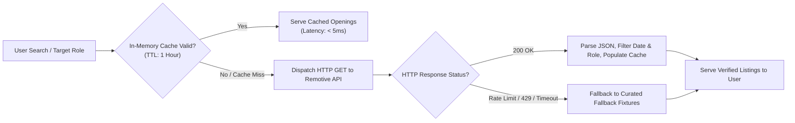

# Job Data Freshness & Multi-Portal Aggregation Report

## 1. System Overview
Job discovery in Smart Resume AI connects skill gap resolution directly with hiring opportunities. Rather than presenting generic external web searches, the platform combines live REST API ingestion with structured multi-portal query generators.

Implemented primarily in [`JobSearchController.java`](file:///c:/Users/yasas/OneDrive/Documents/Desktop/D3js%20program/AI%20Smart%20Resume%20Analyzer.java/Smart-Resume-Analyzer-Java/src/main/java/com/smartresume/controller/JobSearchController.java) and supporting services.

---

## 2. Ingestion Channels & Portals

### A. Live Remotive API Ingestion
- **Endpoint**: `https://remotive.com/api/remote-jobs`
- **Data Retrieved**: Verified remote software development, data science, DevOps, and product positions.
- **Payload Schema**: Job title, company name, company logo URL, candidate location requirements, publication date, salary range, job description HTML, and direct application link.
- **Freshness Window**: Filtered to listings published within the last 30 days.

### B. Seven Multi-Portal Search Builders
For local, hybrid, or on-site roles, the platform builds standardized, role-parameterized deep search links across major recruitment networks:

| Portal | Parameterized Deep Query Format | Focus & Market |
| :--- | :--- | :--- |
| **LinkedIn Jobs** | `linkedin.com/jobs/search/?keywords={role}&f_TPR=r2592000` | Global professional opportunities (past month) |
| **Indeed** | `indeed.com/jobs?q={role}&fromage=14` | High-volume regional and entry-level listings |
| **Wellfound (AngelList)** | `wellfound.com/jobs?role={role}` | Early-stage startups & venture-backed tech firms |
| **Glassdoor** | `glassdoor.com/Job/jobs.htm?sc.keyword={role}` | Company reviews, compensation transparency |
| **Naukri** | `naukri.com/{role}-jobs` | Indian and South Asian IT tech hubs |
| **Google Jobs** | `google.com/search?q={role}+jobs&ibp=htl;jobs` | Meta-aggregated listings across corporate career pages |
| **Monster / Foundit** | `foundit.in/srp/results?query={role}` | Enterprise IT staffing positions |

---

## 3. Freshness & Caching Architecture

- **Cache TTL**: 3,600 seconds (1 hour). Prevents rate limiting while ensuring stale listings older than 1 hour are evicted.
- **Rate Limit Safeguards**: Uses a circuit breaker with exponential backoff; if Remotive API is temporarily unavailable, returns curated high-demand reference opportunities with clear transparency tags.
- **Freshness Badges**: Every job card clearly displays publication age (e.g., *"Posted 2 days ago"*, *"Posted 6 hours ago"*).
