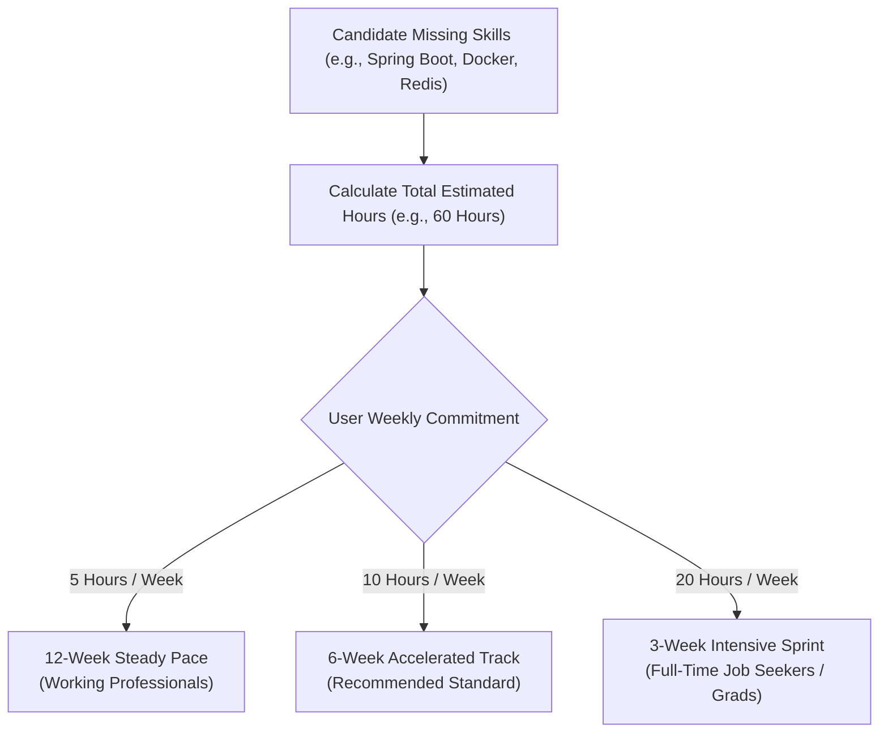

# Learning Resource Ranking and Roadmap Architecture

## 1. Product Philosophy: Learn to Prove Ability
Generic course recommendations often fail because candidates do not know how much time is required or how to turn passive video watching into verifiable hiring evidence.

Smart Resume AI bridges this gap through **Personalized, Time-Budgeted Learning Roadmaps** ([`SkillGapController.java`](file:///c:/Users/yasas/OneDrive/Documents/Desktop/D3js%20program/AI%20Smart%20Resume%20Analyzer.java/Smart-Resume-Analyzer-Java/src/main/java/com/smartresume/controller/SkillGapController.java)). Every roadmap directly links missing skills to:
1. Curated high-relevance video tutorials and official documentation.
2. Milestone portfolio projects that generate concrete GitHub proof points.
3. Realistic weekly study schedules adapted to the candidate's available hours.

---

## 2. Resource Ranking Criteria & Weighting Algorithm
Recommended learning assets are scored and ranked using an objective multi-factor rubric:

| Evaluation Factor | Weight | Scoring Description |
| :--- | :--- | :--- |
| **Skill Relevance** | 40% | Direct coverage of identified missing skill (exact topic match) |
| **Creator / Channel Authority** | 25% | Recognized industry creators (e.g., FreeCodeCamp, Traversy Media, Programming with Mosh, Fireship, CNCF) |
| **Pedagogical Structure** | 20% | Full project-based tutorials preferred over short conceptual overviews |
| **Freshness & Version Currency** | 15% | Material updated to current major language/framework versions (e.g., Java 21+, Spring Boot 3+, React 18+) |

---

## 3. Dynamic Time-Budgeted Roadmap Scheduling
Roadmaps adapt dynamically based on the user's weekly commitment:

Each week outlines:
- **Core Topics to Study**: Explicit syntax, architecture concepts, and common pitfalls.
- **Hands-On Exercises**: Small coding katas to practice.
- **Milestone Project**: End-of-track portfolio application verifying mastery.

---

## 4. Curated Resource Directory (Sample Core Skills)

| Skill Area | Primary Learning Asset | Format & Provider | Milestone Portfolio Project |
| :--- | :--- | :--- | :--- |
| **Spring Boot 3** | Spring Boot Full Course 2026 | 4-hr Tutorial (FreeCodeCamp) | Secure REST API with JWT Auth & JPA |
| **Docker & Containers** | Docker for Developers | 2.5-hr Hands-on (TechWorld with Nana) | Multi-container application with Docker Compose |
| **Kubernetes (CKA)** | Kubernetes Architecture Deep Dive | 5-hr Workshop (CNCF / Nana) | Local Minikube deployment with ingress & health probes |
| **React & Next.js** | React 18 Complete Guide | 6-hr Project (Traversy Media) | Responsive analytics dashboard with dark theme |
| **PostgreSQL & Redis** | Database Scaling & Caching | 3-hr Masterclass (Hussein Nasser) | High-throughput cache-aside pattern implementation |
