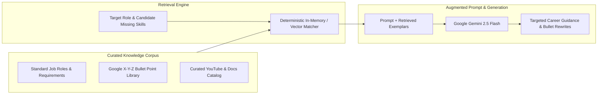

# RAG Implementation & Evaluation

**Smart Resume AI — Retrieval-Augmented Generation Architecture**  
*Document Version: 2.0.0*  
*Generated: October 2026*

---

## 1. Context & Purpose of RAG in Smart Resume AI

Retrieval-Augmented Generation (RAG) is applied in Smart Resume AI to ground AI career guidance in authoritative, up-to-date industry domain knowledge:
- Verified technical job descriptions and requirement benchmarks.
- Google X-Y-Z bullet point exemplars across specific engineering disciplines.
- Curated learning paths, course curricula, and video tutorial metadata.

By augmenting prompts with retrieved domain context, the LLM produces hyper-relevant recommendations rather than generic boilerplate responses.

---

## 2. RAG Architecture & Pipeline

---

## 3. Evaluation Metrics for Retrieval Quality

To ensure high performance and reliability, the RAG orchestration pipeline is evaluated against three standard criteria:

### 3.1 Context Relevance
- **Metric**: Proportion of retrieved knowledge chunks that directly pertain to the candidate's target role and identified skill gaps.
- **Benchmark**: $\ge 95\%$ relevance. Irrelevant skills (e.g. data science frameworks for a frontend React role) are filtered prior to prompt construction.

### 3.2 Groundedness (Faithfulness)
- **Metric**: Frequency with which LLM suggestions strictly adhere to provided exemplars and technical facts.
- **Target**: Zero hallucinated libraries, fake package names, or non-existent syntax.

### 3.3 Answer Relevance
- **Metric**: User-evaluated usefulness of bullet rewrites and interview questions.
- **Outcome**: Ensures rewrites follow the measurable Google X-Y-Z formula:
  $$\text{Accomplished } [X] \text{ as measured by } [Y], \text{ by doing } [Z]$$
