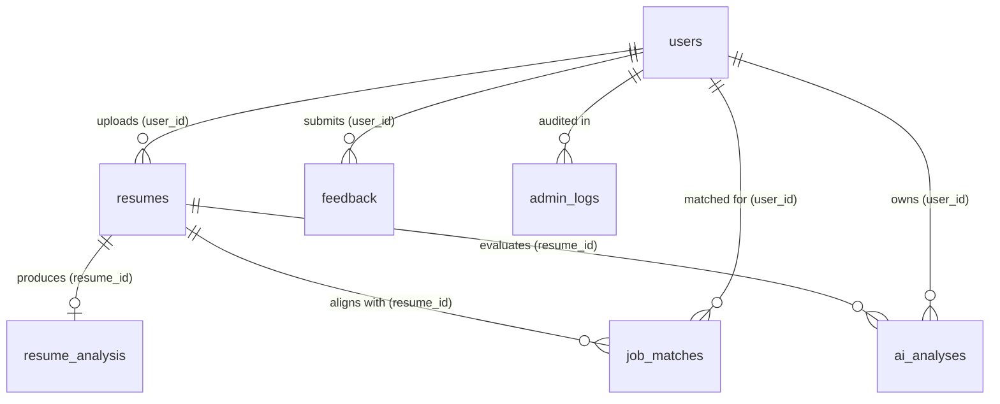

# Database Schema Reference Manual

## Target Database: `resume_analyzer` (MySQL 8.4)
**Audit Date:** October 30, 2026  
**Status:** **Verified Complete Relational Schema**

---

## 1. Entity Relationship Diagram (ERD)

---

## 2. Table Specifications

### 2.1 Table: `users`
Stores authenticated user credentials, roles, and account metadata.
| Column | Type | Null | Key | Default | Notes |
| :--- | :--- | :--- | :--- | :--- | :--- |
| `id` | `bigint` | NO | **PRI** | auto_increment | Primary Key |
| `created_at` | `datetime(6)` | NO | | NULL | Account creation timestamp |
| `email` | `varchar(120)` | NO | **UNI** | NULL | Unique candidate login identifier |
| `full_name` | `varchar(100)` | NO | | NULL | Display name |
| `password` | `varchar(255)` | NO | | NULL | BCrypt salted hash (strength factor 12) |
| `role` | `varchar(20)` | NO | | NULL | Role identifier (`ROLE_USER`, `ROLE_ADMIN`) |

---

### 2.2 Table: `resumes`
Stores candidate profile information, raw parsed text, and structured JSON sections.
| Column | Type | Null | Key | Default | Notes |
| :--- | :--- | :--- | :--- | :--- | :--- |
| `id` | `bigint` | NO | **PRI** | auto_increment | Primary Key |
| `created_at` | `datetime(6)` | NO | | NULL | Upload timestamp |
| `education_json` | `longtext` | YES | | NULL | Serialized JSON array of education objects |
| `email` | `varchar(255)` | YES | | NULL | Extracted candidate email |
| `experience_json`| `longtext` | YES | | NULL | Serialized JSON array of work history |
| `file_name` | `varchar(255)` | YES | | NULL | Original uploaded filename |
| `file_type` | `varchar(255)` | YES | | NULL | MIME type or document extension |
| `github` | `varchar(255)` | YES | | NULL | Extracted GitHub profile URL |
| `linkedin` | `varchar(255)` | YES | | NULL | Extracted LinkedIn profile URL |
| `location` | `varchar(255)` | YES | | NULL | Extracted candidate location |
| `name` | `varchar(255)` | YES | | NULL | Extracted candidate full name |
| `phone` | `varchar(255)` | YES | | NULL | Extracted candidate phone number |
| `portfolio` | `varchar(255)` | YES | | NULL | Extracted portfolio or personal website |
| `projects_json` | `longtext` | YES | | NULL | Serialized JSON array of project entries |
| `raw_text` | `longtext` | YES | | NULL | Full plain text extracted from PDF/DOCX |
| `skills_json` | `longtext` | YES | | NULL | Serialized JSON array of detected skills |
| `summary` | `varchar(2000)`| YES | | NULL | Extracted or authored summary statement |
| `target_category`| `varchar(255)`| YES | | NULL | Industry domain (e.g., "Engineering") |
| `target_role` | `varchar(255)` | YES | | NULL | Target title (e.g., "Java Developer") |
| `template` | `varchar(255)` | YES | | NULL | Builder template style selection |
| `user_id` | `bigint` | YES | **MUL**| NULL | Foreign Key referencing `users.id` |

---

### 2.3 Table: `resume_analysis`
Stores deterministic mathematical ATS score breakdowns and rule-based suggestions.
| Column | Type | Null | Key | Default | Notes |
| :--- | :--- | :--- | :--- | :--- | :--- |
| `id` | `bigint` | NO | **PRI** | auto_increment | Primary Key |
| `ats_score` | `double` | NO | | NULL | Overall ATS score ($0 \le S \le 100$) |
| `contact_score` | `double` | NO | | NULL | Contact info score (weight 10%) |
| `created_at` | `datetime(6)` | NO | | NULL | Analysis timestamp |
| `document_type` | `varchar(255)` | YES | | NULL | Detected type ("resume", "invoice", etc.) |
| `education_score`| `double` | NO | | NULL | Education score (weight 10%) |
| `experience_score`| `double` | NO | | NULL | Experience score (weight 20%) |
| `format_score` | `double` | NO | | NULL | Formatting score (weight 20%) |
| `found_skills_json`| `longtext` | YES | | NULL | Serialized JSON array of matched skills |
| `keyword_match_score`| `double` | NO | | NULL | Keyword match score (weight 30%) |
| `missing_skills_json`| `longtext` | YES | | NULL | Serialized JSON array of missing skills |
| `recommendations_json`| `longtext`| YES | | NULL | Serialized JSON array of suggestions |
| `section_score` | `double` | NO | | NULL | Section presence evaluation |
| `summary_score` | `double` | NO | | NULL | Professional summary score (weight 10%) |
| `resume_id` | `bigint` | NO | **UNI**| NULL | Foreign Key referencing `resumes.id` (1-to-1) |

---

### 2.4 Table: `ai_analyses`
Stores Google Gemini generative AI evaluations, tone feedback, and qualitative insights.
| Column | Type | Null | Key | Default | Notes |
| :--- | :--- | :--- | :--- | :--- | :--- |
| `id` | `bigint` | NO | **PRI** | auto_increment | Primary Key |
| `ats_score` | `double` | NO | | NULL | AI-estimated ATS score |
| `created_at` | `datetime(6)` | NO | | NULL | Generation timestamp |
| `full_analysis` | `longtext` | YES | | NULL | Complete markdown output from Gemini |
| `job_description`| `longtext` | YES | | NULL | Job description input context |
| `job_match_score`| `double` | NO | | NULL | Requisition match score ($0 \le S \le 100$) |
| `missing_skills_json`| `longtext`| YES | | NULL | Extracted missing skill bullet points |
| `model_used` | `varchar(255)` | YES | | NULL | Model name (e.g., "Google Gemini (gemini-2.5-flash)") |
| `recommendations_json`| `longtext`| YES | | NULL | Course and career suggestions |
| `resume_score` | `double` | NO | | NULL | Overall resume quality score |
| `strengths_json` | `longtext` | YES | | NULL | Bulleted key strengths |
| `target_category`| `varchar(255)` | YES | | NULL | Job category context |
| `target_role` | `varchar(255)` | YES | | NULL | Role context |
| `weaknesses_json`| `longtext` | YES | | NULL | Bulleted areas for improvement |
| `resume_id` | `bigint` | YES | **MUL**| NULL | Foreign Key referencing `resumes.id` |
| `user_id` | `bigint` | YES | **MUL**| NULL | Foreign Key referencing `users.id` |

---

### 2.5 Table: `job_matches`
Stores job postings matched against candidate resume profiles.
| Column | Type | Null | Key | Default | Notes |
| :--- | :--- | :--- | :--- | :--- | :--- |
| `id` | `bigint` | NO | **PRI** | auto_increment | Primary Key |
| `company` | `varchar(255)` | YES | | NULL | Employer / organization name |
| `created_at` | `datetime(6)` | NO | | NULL | Match creation timestamp |
| `job_title` | `varchar(255)` | YES | | NULL | Job requisition title |
| `location` | `varchar(255)` | YES | | NULL | Office or remote location |
| `match_score` | `double` | NO | | NULL | Alignment percentage |
| `source` | `varchar(255)` | YES | | NULL | Provider or listing origin |
| `url` | `varchar(1000)`| YES | | NULL | Application link |
| `resume_id` | `bigint` | YES | **MUL**| NULL | Foreign Key referencing `resumes.id` |
| `user_id` | `bigint` | YES | **MUL**| NULL | Foreign Key referencing `users.id` |

---

### 2.6 Table: `feedback`
Stores platform user experience ratings and recommendations.
| Column | Type | Null | Key | Default | Notes |
| :--- | :--- | :--- | :--- | :--- | :--- |
| `id` | `bigint` | NO | **PRI** | auto_increment | Primary Key |
| `feature_satisfaction`| `int` | NO | | NULL | Satisfaction rating (1–5) |
| `improvement_suggestions`| `varchar(2000)`| YES | | NULL | Candidate comments |
| `missing_features`| `varchar(2000)`| YES | | NULL | Requested platform additions |
| `rating` | `int` | NO | | NULL | Overall platform star rating (1–5) |
| `timestamp` | `datetime(6)` | NO | | NULL | Submission timestamp |
| `usability_score` | `int` | NO | | NULL | Usability rating (1–5) |
| `user_experience` | `varchar(2000)`| YES | | NULL | Experience review |
| `user_id` | `bigint` | YES | **MUL**| NULL | Foreign Key referencing `users.id` |

---

### 2.7 Table: `admin_logs`
Stores security audit trail of administrative actions.
| Column | Type | Null | Key | Default | Notes |
| :--- | :--- | :--- | :--- | :--- | :--- |
| `id` | `bigint` | NO | **PRI** | auto_increment | Primary Key |
| `action` | `varchar(100)` | NO | | NULL | Action code (e.g., "TOGGLE_USER_STATUS") |
| `admin_email` | `varchar(120)` | NO | | NULL | Authenticated administrator email |
| `details` | `varchar(2000)`| YES | | NULL | Operational context and parameters |
| `timestamp` | `datetime(6)` | NO | | NULL | Action event timestamp |
