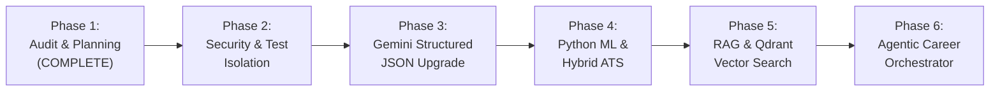

# Controlled Implementation Roadmap

## Project: Smart AI Resume Analyzer
**Version:** 1.0.0-SNAPSHOT  
**Framework:** Java 21 | Spring Boot 3.3.4 | Multi-Phase Evolution  
**Audit Date:** October 2026  
**Status:** Implementation Roadmap (Phase 1 Baseline)

---

## 1. Governance Principles & Strict Guardrails

To ensure zero regressions, complete stability, and architectural integrity throughout the project evolution:
1. **Preservation Gate:** The existing frontend design system, landing page (`index.html`), dark mode aesthetics (`#0B0F19`), and brand identities must remain completely preserved.
2. **Deterministic Fallback:** The application must remain fully functional in standalone mode. If external services (Python ML, Qdrant, or Google Gemini) are unavailable, the core Spring Boot application must gracefully fall back to local rule-based ATS scoring and heuristic generation.
3. **Verification Before Progression:** Every phase must pass 100% of existing and new automated unit and integration tests before proceeding to the subsequent phase.
4. **Zero Unapproved Source Changes:** Phase 1 delivers audit, verification, and planning only. No source code changes are executed without explicit user sign-off.

---

## 2. Phase-by-Phase Execution Plan

---

### Phase 1: Project Inspection, Technical Audit & Documentation (CURRENT)
- **Status:** **COMPLETE**
- **Key Deliverables:**
  - Full codebase inspection (50 Java classes, 15 templates, 8 test suites).
  - Test baseline execution: 22/22 tests passing (100% success rate).
  - 8 Comprehensive audit documents in `docs/audit/`.
  - Zero modifications to application source code or database schemas.

---

### Phase 2: Security Hardening & Test Isolation
- **Objectives:** Eliminate security vulnerabilities identified in the audit and isolate test execution from the production MySQL database.
- **Pre-conditions:** Approval of Phase 1 audit.
- **Tasks:**
  1. Create `src/test/resources/application-test.properties` configuring an in-memory H2 database (`jdbc:h2:mem:testdb;DB_CLOSE_DELAY=-1`) so tests run without requiring a running MySQL server.
  2. Implement magic-byte verification in `FileValidationService.java` (`%PDF-` for PDF, `PK\x03\x04` for DOCX).
  3. Implement PII sanitization in `ResumeParserService.java` (in-memory regex masking for phone numbers and email addresses).
  4. Sanitize CSV exports in `AdminController.java` to prevent formula injection (`=`, `+`, `-`, `@`).
- **Validation Gate:** Run `mvn clean test`. All 22 existing tests + new security test suites must pass against in-memory H2.
- **Rollback Strategy:** Revert changes via Git checkout; verify baseline `mvn test`.

---

### Phase 3: Gemini Structured JSON Mode & Prompt Hardening
- **Objectives:** Replace unstructured free-form text parsing with Gemini's native `response_schema` structured JSON mode and implement prompt injection sandboxing.
- **Pre-conditions:** Phase 2 complete.
- **Tasks:**
  1. Define strict Jackson DTO schemas for Gemini responses (`AiAnalysisResponse.java`).
  2. Update prompt construction in `AIResumeAnalyzerService.java` with XML boundary sandboxing (`<candidate_resume>...</candidate_resume>`).
  3. Configure API request payload to specify `generationConfig: { response_mime_type: "application/json" }`.
  4. Implement client-side rate limiting and token guards.
  5. Retain local heuristic analyzer as instantaneous fallback if API returns 429, 500, or network timeouts.
- **Validation Gate:** Mock Gemini API integration test validating schema parsing and graceful fallback when API key is null or invalid.

---

### Phase 4: Python ML Microservice & Semantic ATS Hybrid Engine
- **Objectives:** Implement the Python FastAPI microservice to provide dense vector embeddings and semantic entity extraction.
- **Pre-conditions:** Phase 3 complete.
- **Tasks:**
  1. Establish `smart-resume-ml-service/` with `requirements.txt` (FastAPI, Pydantic v2, Sentence-Transformers `all-MiniLM-L6-v2`, spaCy, scikit-learn).
  2. Implement `/api/v1/extract-entities` and `/api/v1/semantic-score` endpoints.
  3. Create `SemanticMatchService.java` in Spring Boot using `RestClient` with a 3.0-second timeout.
  4. Evolve `ResumeAnalyzerService.java` into a **Hybrid ATS Engine**:
     $$\text{Hybrid ATS Score} = (0.60 \times \text{Deterministic Rule Score}) + (0.40 \times \text{Semantic ML Vector Score})$$
  5. Implement fallback to 100% deterministic score if Python service is unavailable.
- **Validation Gate:** Automated integration test verifying hybrid score calculation with Python worker both online and offline.

---

### Phase 5: RAG & Qdrant Vector Search Integration
- **Objectives:** Introduce semantic vector storage for resume chunking and job description alignment.
- **Pre-conditions:** Phase 4 complete.
- **Tasks:**
  1. Provide Docker Compose configuration for Qdrant (`qdrant/qdrant:latest`, port 6333).
  2. Implement Qdrant collection creation (`resume_chunks`, 384 dimensions, Cosine distance).
  3. Implement RAG pipeline: chunking resume sections, computing embeddings, indexing vectors with candidate ID metadata.
  4. Build semantic job matching endpoint retrieving top-k aligned job listings grounded on candidate resume embeddings.
- **Validation Gate:** Vector search unit tests verifying indexing, cosine query retrieval, and cross-user data isolation.

---

### Phase 6: Multi-Agent Career Orchestrator & UI Polish
- **Objectives:** Unify all intelligent capabilities under specialized agents and present enriched insights within the existing UI design.
- **Pre-conditions:** Phase 5 complete.
- **Tasks:**
  1. Implement `CareerAgentOrchestrator.java` coordinating:
     - `ResumeAnalysisAgent`
     - `AtsEvaluationAgent`
     - `SkillGapAgent`
     - `JobRecommendationAgent`
     - `CareerPathAgent`
     - `InterviewPreparationAgent`
     - `ApplicationTrackerAgent`
  2. Enhance `templates/resume/results.html` to display new agentic insights (interview questions, skill gap bridges) using existing CSS classes, badge designs, and Chart.js radar charts.
  3. Verify end-to-end user journey: Upload -> Deterministic + Semantic Scoring -> RAG Alignment -> Interview Prep -> Preserved Dashboard.
- **Validation Gate:** End-to-end automated UI and API workflow verification; full build verification (`mvn clean verify`).
