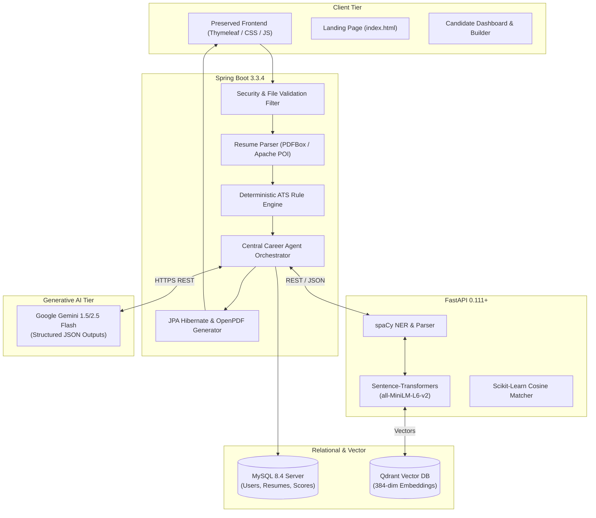

# Target Technology & Multi-Agent Architecture

## Project: Smart AI Resume Analyzer
**Version:** 1.0.0-SNAPSHOT  
**Framework:** Java 21 | Spring Boot 3.3.4 | Python ML | Google Gemini | Qdrant  
**Audit Date:** October 2026  
**Status:** Target Architecture Blueprint (Phase 1 Planning)

---

## 1. Architectural Vision

The target architecture evolves the Smart AI Resume Analyzer from a monolithic rule-based Spring Boot application into a **Modular Hybrid AI Intelligence Platform**. The platform combines:
1. **A Resilient Enterprise Core:** Java 21 + Spring Boot 3.3.4 handling authentication, business logic, file security, document generation, and relational persistence.
2. **A High-Performance Semantic Microservice:** Python FastAPI worker executing NLP, spaCy entity extraction, and Sentence Transformers embeddings.
3. **Enterprise Vector Search (RAG):** Qdrant Vector Database storing chunked resume embeddings and job requisition vectors for semantic similarity matching.
4. **Multi-Agent Orchestration:** Specialized autonomous agents coordinating resume evaluation, skill gap diagnostics, market alignment, and interview readiness.
5. **Preserved Visual Experience:** Retaining 100% of the existing dark-mode landing page, Thymeleaf layouts, Chart.js visualizations, and Bootstrap design system.

---

## 2. High-Level Architecture Diagram



---

## 3. Technology Evaluation (The 8 Dimensions)

### 3.1 Primary Application Core (Java 21 + Spring Boot 3.3.4)
1. **Core Role & Purpose:** Central backbone orchestrating HTTP request lifecycles, user identity/security, transactional relational integrity, document file processing, and Thymeleaf UI rendering.
2. **Why Best Fit vs. Alternatives:** Superior enterprise stability, type safety, Virtual Threads (Project Loom) for lightweight asynchronous concurrency, and deep integration with Spring Security 6.
3. **Exact Place in Architecture:** Primary Web Application Gateway and Central Orchestrator.
4. **Interaction with Existing Components:** Reuses 100% of existing controllers, services, repositories, and domain entities.
5. **Value Added:** Guaranteed data consistency, deterministic ATS scoring fallback, secure session lifecycle, and seamless binary file generation.
6. **Technical Risks & Costs:** Minimal risk; already compiled, tested, and running in production baseline.
7. **Fallback Behavior:** Self-sufficient standalone operation; can run ATS scoring and resume generation even if external AI is unreachable.
8. **Evaluation Decision:** **ADOPT IMMEDIATELY (Active Foundation).**

---

### 3.2 Python ML Service (FastAPI + spaCy + Sentence-Transformers)
1. **Core Role & Purpose:** Performs heavy natural language processing, semantic entity extraction, and dense vector embeddings (`all-MiniLM-L6-v2`).
2. **Why Best Fit vs. Alternatives:** Python has an unmatched ecosystem for NLP/ML; running this in a lightweight FastAPI microservice avoids bloating the JVM classpath with native C++ bindings.
3. **Exact Place in Architecture:** Sidecar microservice operating on `http://127.0.0.1:8000`.
4. **Interaction with Existing Components:** Java `ResumeAnalyzerService` queries FastAPI via Spring `RestClient` with a 3-second timeout.
5. **Value Added:** Enhances keyword matching to semantic concept matching (e.g., recognizing that "AWS Lambda" matches "Serverless Cloud Computing").
6. **Technical Risks & Costs:** Requires Python 3.11/3.12 runtime and ~500MB RAM for model weights in memory.
7. **Fallback Behavior:** If the Python microservice is offline or times out, Java backend seamlessly defaults to the deterministic rule-based string matching formula.
8. **Evaluation Decision:** **ADOPT IN PHASE 3 (Modular Semantic Service).**

---

### 3.3 Google Gemini LLM (Structured JSON Outputs)
1. **Core Role & Purpose:** Generates qualitative career diagnostics, executive summaries, resume section rewrite recommendations, and interview preparation questions.
2. **Why Best Fit vs. Alternatives:** Ultra-low latency, 1M+ token context window, competitive pricing, native support for `response_schema` structured JSON mode.
3. **Exact Place in Architecture:** Cloud AI reasoning engine invoked asynchronously via Java's `HttpClient`.
4. **Interaction with Existing Components:** Invoked by `AIResumeAnalyzerService.java` post-parsing.
5. **Value Added:** Replaces robotic boilerplate feedback with contextual, industry-grounded coaching.
6. **Technical Risks & Costs:** External API rate limits and network dependency.
7. **Fallback Behavior:** Built-in heuristic AI analyzer in `AIResumeAnalyzerService.java` immediately synthesizes local deterministic feedback if Gemini returns 429/500.
8. **Evaluation Decision:** **ADOPT IMMEDIATELY (Hardened Schema Mode).**

---

### 3.4 Vector Database: Qdrant
1. **Core Role & Purpose:** Vector indexing and high-speed semantic similarity search for resumes, skill taxonomies, and job requisitions.
2. **Why Best Fit vs. Alternatives:** Written in Rust, ultra-lightweight memory footprint, fast payload filtering, rich REST and gRPC API, easy single-container Docker deployment.
3. **Exact Place in Architecture:** Vector search layer accessed by the Python ML service and Job Recommendation Agent.
4. **Interaction with Existing Components:** Stores embeddings indexed by `resume_id` and `job_id`.
5. **Value Added:** Powers instant semantic RAG retrieval and role-to-candidate alignment without manual keyword tagging.
6. **Technical Risks & Costs:** Requires Docker container or managed Qdrant cloud cluster.
7. **Fallback Behavior:** Fall back to MySQL SQL query matching (`LIKE %keyword%` and boolean flags).
8. **Evaluation Decision:** **ADOPT IN PHASE 4 (Semantic Vector Search & RAG).**

---

### 3.5 Agentic AI Ecosystem (Specialized Role Agents)
1. **Core Role & Purpose:** Coordinates specialized sub-tasks into a unified, intelligent candidate career journey.
2. **Why Best Fit vs. Alternatives:** A monolithic prompt leads to hallucinations and diluted feedback. Decentralizing into specialized agents yields higher accuracy and modular testability.
3. **Exact Place in Architecture:** Orchestration layer residing in Java backend communicating with Python ML and Gemini.
4. **Specialized Agents:**
   - **Central Career Agent Orchestrator:** Manages state machines, request pipelines, and aggregates agent outputs.
   - **Resume Analysis Agent:** Evaluates structure, completeness, grammar, and readability.
   - **ATS Evaluation Agent:** Computes quantitative keyword alignment and formatting scores.
   - **Skill Gap Agent:** Compares candidate skills against live industry requirements and identifies deficiencies.
   - **Job Recommendation Agent:** Searches vector database for hyper-aligned job requisitions.
   - **Career Path Agent:** Formulates a 3-stage actionable roadmap (certifications, open-source projects, timeline).
   - **Interview Preparation Agent:** Generates tailored behavioral and technical interview questions based on the candidate's specific resume weaknesses.
   - **Application Tracker Agent:** Manages candidate submission statuses, follow-up reminders, and interview schedules.
5. **Value Added:** Turns a passive "score checker" into a complete career intelligence companion.
6. **Technical Risks & Costs:** Coordination complexity; mitigated by strict JSON schema contracts.
7. **Fallback Behavior:** Each agent executes independently; failure of one agent does not invalidate the output of other agents.
8. **Evaluation Decision:** **ADOPT IN PHASE 5 (Multi-Agent Intelligence).**

---

## 4. End-to-End Processing Pipeline

```
Candidate Uploads PDF/DOCX
       |
       v
[FileValidationService] ---> (Validates MIME, magic bytes, max 10MB)
       |
       v
[ResumeParserService] ---> (Extracts text via PDFBox/POI + applies PII Masking)
       |
       v
[ResumeAnalyzerService] ---> (Calculates Baseline Deterministic ATS Formula: 0-100)
       |
       +---------------------------------------------+
       |                                             |
       v (Internal Call)                             v (External Call)
[Python ML Worker]                            [AIResumeAnalyzerService]
- spaCy NER extraction                        - Google Gemini 1.5 Flash
- Sentence Transformer Embeddings (384-dim)   - Structured JSON schema output
- Cosine similarity matching                  - Tone, Strengths, Weaknesses
       |                                             |
       +----------------------+----------------------+
                              |
                              v
             [Central Career Agent Orchestrator]
             - Synthesizes Quantitative + Qualitative Data
             - Triggers Skill Gap & Job Match Agents
             - Persists records to MySQL (JPA) & Qdrant
                              |
                              v
                  [Thymeleaf Results View]
                  - Preserved Circular Gauge UI
                  - Chart.js Radar Charts
                  - Interactive Skill Badges & Action Plan
```
